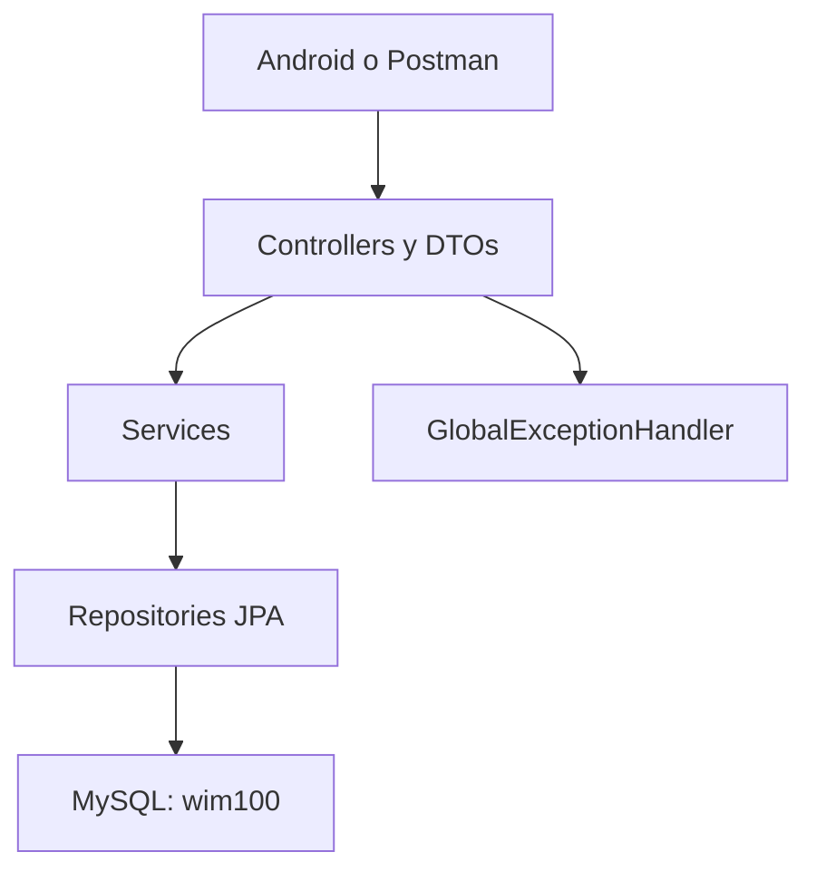

# WIM100 — Backend Spring Boot

API REST del proyecto académico WIM100 para registrar postulantes de ciberseguridad y validar el acceso del equipo de Evaluadora y Dirección. Utiliza Spring Boot, Java, Spring Data JPA y MySQL.

| Repositorio | Responsabilidad |
| --- | --- |
| [wim100-backend](https://github.com/BastianHuenchullan/wim100-backend) | Este servicio: postulantes, usuarios, login y persistencia MySQL. |
| [DesarrolloMovil](https://github.com/DanielEscalanteS/DesarrolloMovil) | App Android: formularios, evaluación, comparación, historial local y recursos nativos. |

## Contenido

1. [Alcance y arquitectura](#1-alcance-y-arquitectura)
2. [Tecnologías y organización](#2-tecnologías-y-organización)
3. [Modelo y contrato de datos](#3-modelo-y-contrato-de-datos)
4. [Ejecución local](#4-ejecución-local)
5. [Ejecución con Docker](#5-ejecución-con-docker)
6. [Datos iniciales y login](#6-datos-iniciales-y-login)
7. [API de postulantes](#7-api-de-postulantes)
8. [Validación y errores](#8-validación-y-errores)
9. [Integración Android y RandomUser](#9-integración-android-y-randomuser)
10. [Pruebas y Postman](#10-pruebas-y-postman)
11. [Solución de problemas](#11-solución-de-problemas)
12. [Límites y pendientes](#12-límites-y-pendientes)
13. [Trabajo colaborativo](#13-trabajo-colaborativo)
14. [Evaluaciones y puntajes por criterio](#14-evaluaciones-y-puntajes-por-criterio)
15. [Documentación y entrega según la guía](#15-documentación-y-entrega-según-la-guía)

## 1. Alcance y arquitectura

El backend es la fuente oficial de postulantes y usuarios. Ofrece altas, consultas, actualización de antecedentes, cambio de estado, eliminación y validación de credenciales.

La rama `fix/actualizacion-api` agrega almacenamiento de evaluaciones y puntajes por criterio en MySQL, mediante `GET` y `POST /api/evaluaciones`. Criterios e historial siguen en Room, según la arquitectura híbrida permitida por la guía. Tampoco almacena archivos PDF: recibe solamente su nombre.

Esta versión corresponde al commit `fda0e48fb420132370409b085d74db2563cdf370`, un commit por delante de `main` al 22 de noviembre de 2026. Se integra con Android `fix/dtos-y-tests`, commit `c563f5c`.



Los controllers reciben las peticiones y activan Validation. Los services aplican la lógica existente. Los repositories consultan MySQL y las excepciones previstas se traducen a respuestas HTTP.

## 2. Tecnologías y organización

| Componente | Configuración del código revisado |
| --- | --- |
| Java | 17 en `pom.xml` y las imágenes Docker. |
| Spring Boot | 4.1.2, según el parent de `pom.xml`. |
| Construcción | Maven y Wrapper incluido. |
| Web | `spring-boot-starter-webmvc`. |
| Persistencia | Spring Data JPA, Hibernate y MySQL. |
| Validación | Jakarta Validation con starter de Spring Boot. |
| Código auxiliar | Lombok. |
| Contraseñas | BCrypt mediante `spring-security-crypto`. |
| Puerto HTTP | 8080. |
| Base de datos | `wim100`. |

El proyecto usa `spring-security-crypto`, sin `spring-boot-starter-security`. BCrypt se utiliza para comparar hashes, no para proteger automáticamente las rutas. No se documenta aquí una versión de Spring distinta de la declarada en el repositorio.

Las rutas de código parten de `src/main/java/cl/duoc/wim100/`.

| Carpeta o archivo | Responsabilidad |
| --- | --- |
| `Wim100BackendApplication.java` | Inicio de Spring Boot. |
| `model/` | Entidades `Postulante`, `Usuario`, `Evaluacion`, `PuntajeCriterio` y enums. |
| `repository/` | Acceso JPA, búsqueda de usuario y controles de correo. |
| `service/PostulanteService.java` | Consultas, alta, edición, cambio de estado y eliminación. |
| `service/AuthService.java` | Búsqueda de cuenta y comparación BCrypt. |
| `controller/PostulanteController.java` | Rutas `/api/postulantes`. |
| `controller/AuthController.java` | Ruta `/api/auth/login`. |
| `controller/EvaluacionController.java` | GET y POST `/api/evaluaciones`, con DTOs internos. |
| `repository/EvaluacionRepository.java` | Busca por postulante y clave de evaluadora. |
| `repository/PuntajeCriterioRepository.java` | Recupera puntajes por evaluación. |
| `dto/` | Cuerpos y respuestas: `PostulanteRequest`, `EstadoRequest`, `LoginRequest`, `LoginResponse`, `ErrorResponse`. |
| `exception/` | Excepciones previstas y `GlobalExceptionHandler`. |
| `config/PasswordConfig.java` | Bean `PasswordEncoder` con BCrypt. |
| `config/DataLoader.java` | Carga inicial si cada tabla está vacía. |

Otros archivos:

- `src/main/resources/application.properties`: conexión MySQL y puerto.
- `src/test/java/cl/duoc/wim100/Wim100BackendApplicationTests.java`: prueba de carga de contexto.
- `postman/wim100.postman_collection.json`: solicitudes de demostración.
- `Dockerfile` y `docker-compose.yml`: construcción y arranque con MySQL.

## 3. Modelo y contrato de datos

### Postulante

La entidad JPA utiliza la tabla `postulantes`. Los mismos nombres viajan en JSON y se corresponden con `PostulanteDto` en Android.

| Campo | Tipo Java | Uso |
| --- | --- | --- |
| `id` | `Long` | Identificador autogenerado. |
| `nombre` | `String` | Nombre de la candidata. |
| `correo` | `String` | Correo único. |
| `telefono` | `String` | Contacto. |
| `area` | `String` | Especialidad profesional. |
| `aniosExperiencia` | `Integer` | Años de experiencia. |
| `resumenExperiencia` | `String` | Antecedentes. |
| `linkedinUrl` | `String` | Enlace ingresado en el formulario. |
| `cvNombre` | `String`, admite nulo | Nombre del CV; no es un archivo. |
| `estado` | `EstadoPostulante` | Se serializa como nombre del enum. |
| `fechaRegistro` | `Long` | Milisegundos desde epoch. |
| `registradaPor` | `String` | Nombre registrado como responsable del alta. |

`cvUri` no pertenece al contrato remoto. La app lo conserva localmente.

### Enums exactos

| Enum | Valores |
| --- | --- |
| `EstadoPostulante` | `POSTULADA`, `EN_EVALUACION`, `EVALUADA`, `SELECCIONADA`, `NO_SELECCIONADA`. |
| `Rol` | `EVALUADORA`, `DIRECCION`. |

La app permite enviar una postulación pública sin agregar un rol POSTULANTE ni crear una cuenta.

### Usuario

La entidad `Usuario` usa la tabla `usuarios`: `id`, `usuario`, `password`, `nombre` y `rol`. `password` contiene el hash BCrypt. El login devuelve `LoginResponse` y no devuelve la contraseña ni el hash.

No se expone un endpoint de registro o administración de usuarios en esta versión.

## 4. Ejecución local

### Requisitos

- JDK 17 y `JAVA_HOME` apuntando al JDK correspondiente.
- MySQL configurado y en ejecución; el entorno Docker utiliza MySQL 8.0.
- Puertos disponibles: MySQL local 3306 y backend 8080.
- Acceso a dependencias Maven en la primera construcción.

Si todavía no se tiene el repositorio:

```powershell
git clone https://github.com/BastianHuenchullan/wim100-backend.git
cd wim100-backend
```

Abrir en el IDE la raíz que contiene `pom.xml`. La referencia del backend revisado es `fix/actualizacion-api`; conservar los cambios propios antes de cambiar de rama.

### Conexión MySQL predeterminada

`src/main/resources/application.properties` utiliza:

```properties
spring.application.name=wim100-backend
server.port=8080
spring.datasource.url=jdbc:mysql://localhost:3306/wim100?createDatabaseIfNotExist=true&useSSL=false&allowPublicKeyRetrieval=true&serverTimezone=America/Santiago
spring.datasource.username=root
spring.datasource.password=
spring.jpa.hibernate.ddl-auto=update
spring.jpa.show-sql=true
spring.jpa.open-in-view=false
```

`createDatabaseIfNotExist=true` permite crear la base si el usuario de MySQL tiene permiso. Hibernate prepara o actualiza las tablas mediante `ddl-auto=update`. Si el entorno lo requiere, crear primero `wim100` y ajustar usuario, contraseña o puerto.

### Arranque

En PowerShell:

```powershell
java -version
.\mvnw.cmd -version
.\mvnw.cmd spring-boot:run
```

En Linux o macOS:

```bash
java -version
bash ./mvnw -version
bash ./mvnw spring-boot:run
```

También se puede ejecutar `Wim100BackendApplication` desde el IDE con el JDK configurado. La aplicación debe quedar atendiendo en `http://localhost:8080`.

Comprobar:

```powershell
Invoke-RestMethod -Method Get -Uri "http://localhost:8080/api/postulantes"
```

Para detener la ejecución de terminal, utilizar Ctrl+C. El frontend Android es otro proyecto y se ejecuta por separado.

## 5. Ejecución con Docker

Requiere Docker con soporte de Compose. Desde la raíz:

```bash
docker compose up --build -d
docker compose ps
docker compose logs -f backend
```

| Servicio Compose | Contenedor | Acceso |
| --- | --- | --- |
| `db` | `mysql-wim100` | MySQL 8.0, `localhost:3306`, root y contraseña `root`. |
| `backend` | `backend-wim100` | HTTP `localhost:8080`; espera el healthcheck de MySQL. |

Dentro de Docker, el backend se conecta a `db:3306`. Las variables del Compose establecen usuario `root` y contraseña `root`. La configuración local de `application.properties` utiliza contraseña vacía; son dos alternativas de ejecución diferentes.

No ejecutar MySQL local y Docker publicando simultáneamente el mismo puerto 3306. Tampoco ejecutar dos backends en 8080. La rama anterior publicaba MySQL en 3307, pero esta actualización utiliza **3306**.

El Dockerfile construye con Maven y Java 17 y ejecuta el JAR con una imagen JRE 17. Usa `-DskipTests`; construir la imagen no acredita pruebas aprobadas. El Compose no declara un volumen persistente explícito y requiere una estrategia de respaldo si se conservarán los datos entre recreaciones.

Para detener sin eliminar los contenedores:

```bash
docker compose stop
```

## 6. Datos iniciales y login

### Carga inicial

`DataLoader` comprueba usuarios y postulantes por separado. Si una tabla está vacía, agrega sus ejemplos; si ya contiene registros, no completa ni restablece los faltantes.

| Usuario | Contraseña de demostración | Nombre | Rol |
| --- | --- | --- | --- |
| `evaluadora1` | `wim2026` | Camila Rojas Demo | `EVALUADORA` |
| `evaluadora2` | `wim2026` | Valentina Munoz Demo | `EVALUADORA` |
| `direccion` | `wim2026` | Direccion WIM Demo | `DIRECCION` |

Las contraseñas se codifican con BCrypt al crear los ejemplos.

| Candidata inicial | Área |
| --- | --- |
| Ignacia Valdes Soto | Seguridad ofensiva (Red Team). |
| Martina Herrera Lagos | Seguridad defensiva (Blue Team). |
| Fernanda Castillo Rivas | Gobierno, riesgo y cumplimiento. |

Se crean en `POSTULADA`, con fecha del servidor, responsable `Carga inicial` y nombre de CV ilustrativo. No se crean archivos PDF ni evaluaciones. Sus áreas son distintas: para comparar desde Android se necesitan al menos dos candidatas evaluadas de la misma área en la copia local disponible para Dirección, después del refresco.

### POST /api/auth/login

```json
{
  "usuario": "evaluadora1",
  "password": "wim2026"
}
```

Respuesta ilustrativa `200` —el ID puede variar—:

```json
{
  "id": 1,
  "usuario": "evaluadora1",
  "nombre": "Camila Rojas Demo",
  "rol": "EVALUADORA"
}
```

`AuthService` recorta y convierte el usuario a minúsculas y compara la contraseña mediante `PasswordEncoder.matches`. Campos vacíos producen `400`; credenciales incorrectas, `401`.

La respuesta no contiene token ni crea una sesión de servidor. La biometría adicional de Dirección se ejecuta en Android, después del login; no es un endpoint del backend.

## 7. API de postulantes

URL base: `http://localhost:8080/api/`. Los cuerpos JSON se envían con `Content-Type: application/json`.

| Método | Ruta | Resultado |
| --- | --- | --- |
| GET | `/api/postulantes` | 200, lista por `fechaRegistro` descendente. |
| GET | `/api/postulantes/{id}` | 200 con un registro, o 404. |
| POST | `/api/postulantes` | 201, 400 o 409. |
| PUT | `/api/postulantes/{id}` | 200, 400, 404 o 409. |
| PATCH | `/api/postulantes/{id}/estado` | 200, 400 si el cuerpo es inválido o 404. |
| DELETE | `/api/postulantes/{id}` | 204 sin cuerpo, o 404. |

Junto con el login, son siete operaciones HTTP originales. Los GET y POST de evaluaciones, descritos en la sección 14, elevan el total a nueve. No hay paginación ni filtros por query en el listado actual; Android aplica sus filtros sobre la copia local.

### Crear: POST /api/postulantes

Cuerpo `PostulanteRequest`:

```json
{
  "nombre": "Ana Prueba",
  "correo": "ana.prueba01@example.com",
  "telefono": "+56912345678",
  "area": "Seguridad defensiva (Blue Team)",
  "aniosExperiencia": 3,
  "resumenExperiencia": "Tengo experiencia en monitoreo de seguridad y análisis de incidentes informáticos.",
  "linkedinUrl": "https://www.linkedin.com/in/ana-prueba",
  "cvNombre": "cv-ana-prueba.pdf",
  "registradaPor": "Ana Prueba"
}
```

No enviar `id`, `estado`, `fechaRegistro` ni `cvUri` como parte de este DTO. El servidor genera ID, establece `POSTULADA` y asigna su fecha actual. `registradaPor` viene en la petición; en el formulario público se utiliza el nombre de la candidata y en el formulario del equipo, el nombre de su sesión.

Respuesta ilustrativa `201`; ID y fecha no son valores fijos:

```json
{
  "id": 42,
  "nombre": "Ana Prueba",
  "correo": "ana.prueba01@example.com",
  "telefono": "+56912345678",
  "area": "Seguridad defensiva (Blue Team)",
  "aniosExperiencia": 3,
  "resumenExperiencia": "Tengo experiencia en monitoreo de seguridad y análisis de incidentes informáticos.",
  "linkedinUrl": "https://www.linkedin.com/in/ana-prueba",
  "cvNombre": "cv-ana-prueba.pdf",
  "estado": "POSTULADA",
  "fechaRegistro": 1795258800000,
  "registradaPor": "Ana Prueba"
}
```

El servicio recorta textos, normaliza espacios del nombre y convierte el correo a minúsculas. Un correo repetido, sin distinguir mayúsculas, produce `409`.

### Consultar: GET

`GET /api/postulantes` devuelve una lista de objetos con el formato anterior, ordenada por fecha descendente. Una lista vacía es una respuesta válida `200`.

`GET /api/postulantes/{id}` devuelve un objeto. Un ID inexistente produce `404`.

### Editar: PUT /api/postulantes/{id}

Utiliza el mismo `PostulanteRequest` de creación, con todos sus campos requeridos. Actualiza los antecedentes y conserva ID, estado, fecha de registro y responsable original. Aunque `registradaPor` sigue siendo obligatorio en el DTO, el servicio no lo reemplaza al editar.

El control de correo excluye el ID que se está editando. Por eso conservar el correo actual es válido; usar el de otra candidata produce `409`.

### Estado: PATCH /api/postulantes/{id}/estado

```json
{"estado": "EVALUADA"}
```

Devuelve el postulante actualizado. El cuerpo acepta los valores exactos de `EstadoPostulante`. Cambiar el estado no crea una evaluación ni almacena sus notas.

El servicio actual asigna el enum recibido sin comprobar el flujo de negocio completo. Las condiciones para evaluar, seleccionar o rechazar se verifican en Android. Aunque ahora existen evaluaciones en MySQL, este servicio todavía no las consulta para validar una resolución.

### Eliminar: DELETE /api/postulantes/{id}

Elimina un registro existente y devuelve `204`, sin cuerpo. Un ID inexistente devuelve `404`. No se debe intentar interpretar una respuesta 204 como JSON.

La app elimina después su copia local, con sus evaluaciones y notas locales por cascada. El backend no elimina información de otros teléfonos de manera automática.

## 8. Validación y errores

### Reglas de PostulanteRequest

| Campo | Validación del backend |
| --- | --- |
| `nombre` | No vacío; entre 3 y 60 caracteres. |
| `correo` | No vacío y formato de correo. Unicidad comprobada por el servicio y columna única. |
| `telefono` | No vacío; hasta 20 caracteres. |
| `area` | No vacía. |
| `aniosExperiencia` | No nulo; entero entre 0 y 50. |
| `resumenExperiencia` | No vacío; entre 30 y 500 caracteres. |
| `linkedinUrl` | No vacío; comienza con `https://`. |
| `cvNombre` | Opcional; no valida el contenido de un PDF. |
| `registradaPor` | No vacío. |

Android agrega reglas propias como dominio de correo ficticio, formato más específico de LinkedIn y validación real del PDF. El backend no limita el correo a dominios de ejemplo ni valida que `area` pertenezca al catálogo de Android.

### ErrorResponse

`GlobalExceptionHandler` unifica las excepciones previstas:

| Excepción | HTTP |
| --- | --- |
| `RecursoNoEncontradoException` | 404. |
| `CorreoDuplicadoException` | 409. |
| `CredencialesInvalidasException` | 401. |
| `MethodArgumentNotValidException` | 400, con errores de campos. |

Ejemplo de validación:

```json
{
  "status": 400,
  "mensaje": "Datos invalidos",
  "errores": {"nombre": "El nombre es obligatorio"}
}
```

Ejemplo de duplicado:

```json
{
  "status": 409,
  "mensaje": "Ya existe una candidatura con este correo",
  "errores": {}
}
```

JSON mal formado, un enum desconocido u otras excepciones del framework no tienen un manejador propio en esta clase y pueden utilizar el formato de error de Spring. Android contempla una alternativa de mensaje por código HTTP.

## 9. Integración Android y RandomUser

| Cliente | URL base del backend |
| --- | --- |
| Computador / Postman | `http://localhost:8080/api/` |
| Android Emulator | `http://10.0.2.2:8080/api/` |
| Teléfono físico | `http://IP_DEL_COMPUTADOR:8080/api/` |

La app configura esta dirección en `data/remote/RetrofitClient.kt` y conserva una copia de postulantes en Room. El teléfono físico necesita comunicación con el computador y acceso al puerto 8080.

RandomUser es consumido **directamente desde Android**, no desde este backend:

```http
GET https://randomuser.me/api/?gender=female&nat=es&inc=name
```

La opción Usar nombre de ejemplo del formulario de Evaluadora completa solo el nombre. No se incluye en el formulario público ni guarda una candidatura automáticamente. No hay extracción de perfiles de LinkedIn.

## 10. Pruebas y Postman

### Colección incluida

Importar `postman/wim100.postman_collection.json`. Su variable `baseUrl` es `http://localhost:8080`, sin `/api/`, porque las rutas de la colección ya lo incluyen.

Las nueve solicitudes son: login correcto, login incorrecto, listado, consulta por ID, alta, alta inválida, edición, cambio de estado y eliminación. Ajustar los IDs a registros reales y usar correos nuevos para las altas.

La colección contiene ejemplos, sin scripts automáticos de aserción. Nueve solicitudes no significan nueve endpoints diferentes ni una batería automática aprobada. Para comprobar el contrato completo, añadir manualmente los casos de correo duplicado e ID inexistente.

### Comprobación rápida desde PowerShell

```powershell
$login = @{ usuario = "evaluadora1"; password = "wim2026" } | ConvertTo-Json
Invoke-RestMethod -Method Post -Uri "http://localhost:8080/api/auth/login" -ContentType "application/json" -Body $login

Invoke-RestMethod -Method Get -Uri "http://localhost:8080/api/postulantes"
```

### Casos recomendados

| Caso | Resultado esperado |
| --- | --- |
| Login con cuenta inicial | 200 y campos id, usuario, nombre y rol. |
| Contraseña equivocada | 401. |
| Login vacío | 400. |
| Alta válida | 201; estado POSTULADA, ID y fecha asignados. |
| Alta inválida | 400 con errores de campos cuando aplica Validation. |
| Correo repetido, incluso con otra capitalización | 409. |
| Consultar ID inexistente | 404. |
| Editar el mismo registro con su correo | 200; mantiene ID, estado, fecha y responsable. |
| Editar usando el correo de otro registro | 409. |
| Cambiar a un estado válido | 200 con el estado enviado. |
| Eliminar una candidata de prueba | 204; luego GET de ese ID devuelve 404. |

### Pruebas Maven

Con MySQL y la configuración requeridos disponibles:

```powershell
.\mvnw.cmd test
.\mvnw.cmd clean package
```

En Linux o macOS: `bash ./mvnw test` y `bash ./mvnw clean package`. El JAR se genera en `target/wim100-backend-0.0.1-SNAPSHOT.jar`.

El código revisado contiene una prueba `contextLoads` con `@SpringBootTest`. No utiliza una base aislada: carga la configuración real y puede ejecutar DataLoader. Utilizar una base de pruebas apropiada si no se desea inicializar el entorno de trabajo.

Se comprobó la compilación y empaquetado del commit `fda0e48` mediante Maven con `-DskipTests package`: resultado BUILD SUCCESS. No se ejecutaron aquí Docker, pruebas del backend contra MySQL ni una batería HTTP completa. Android `c563f5c` generó APK debug y aprobó 79 pruebas unitarias; estos resultados no acreditan cobertura ni tests del backend.

## 11. Solución de problemas

| Problema | Comprobar |
| --- | --- |
| `JAVA_HOME` incorrecto o Maven usa otra versión | `java -version`, `.\mvnw.cmd -version` y JDK del IDE; el proyecto declara Java 17. |
| MySQL no conecta | Servicio activo, host, puerto, usuario, contraseña y permiso para crear o usar `wim100`. |
| Puerto 8080 ocupado | Detener la otra instancia o coordinar otro puerto y actualizar también Android. |
| Cuenta de ejemplo no funciona | Tabla usuarios existente: DataLoader no restablece sus registros. |
| Postman consulta el puerto equivocado | API en 8080; MySQL local o Docker en 3306. |
| App no conecta pero Postman sí | URL `10.0.2.2` en emulador, IP en teléfono y permisos/red local. |
| Se recibe 409 | Revisar correo duplicado antes de volver a enviar. |
| Otro teléfono no ve notas o PDF | Dirección descarga notas al refrescar; el PDF permanece local. El refresco de Evaluadora aún no descarga evaluaciones. |
| Falta información tras recrear contenedores | El Compose no configura un volumen persistente explícito; revisar respaldos y volúmenes del entorno. |

## 12. Límites y pendientes

- El login compara credenciales, pero no hay tokens ni autorización de endpoints por rol. `registradaPor` es un texto de la petición, no una identidad autenticada comprobada por el servidor.
- Las reglas de una evaluación por candidata, edición por responsable y resolución están en Android y su base local. No se garantizan globalmente entre teléfonos.
- Los puntajes viajan con la evaluación; no hay endpoints para administrar la definición de criterios, historial ni archivos. Cambiar a EVALUADA mediante PATCH, por sí solo, no transmite notas.
- No existe control de transiciones del enum en el servicio, versionado optimista del postulante ni coordinación de cambios simultáneos entre clientes.
- Los datos y las cuentas iniciales son de demostración. La configuración de MySQL sin contraseña y HTTP local corresponde a ese entorno.
- El Compose requiere definir una estrategia explícita de persistencia y respaldo antes de depender de sus datos.
- Quedan por ampliar las pruebas automáticas del backend y los escenarios de error de Postman. No se acredita un porcentaje de cobertura en este README.

Estos puntos documentan la implementación revisada; no indican cambios de código realizados como parte de esta actualización documental.

## 13. Trabajo colaborativo

El equipo trabaja con ramas, commits en español y pull requests hacia `main`. Mantener los nombres y rutas del contrato para no romper Retrofit. Las modificaciones de DTOs, enums o endpoints deben coordinarse entre ambos repositorios.

Integrantes: [BastianHuenchullan](https://github.com/BastianHuenchullan), [DanielEscalanteS](https://github.com/DanielEscalanteS) y [JojitaGamerHD](https://github.com/JojitaGamerHD).

**Código de referencia para esta documentación:** `fix/actualizacion-api`, commit `fda0e48fb420132370409b085d74db2563cdf370`, revisado el 22 de noviembre de 2026. Android compatible: `fix/dtos-y-tests`, `c563f5c`.


## 14. Evaluaciones y puntajes por criterio

Las tablas nuevas son `evaluaciones` y `puntajes_criterio`. Guardan IDs de referencia como campos numéricos; el modelo JPA revisado no declara relaciones ni llaves foráneas entre ellas y postulantes. Tampoco declara una restricción única global por postulante.

| Método | Endpoint | Respuesta implementada |
| --- | --- | --- |
| GET | `/api/evaluaciones` | 200 y lista con puntajes. |
| POST | `/api/evaluaciones` | 200 y evaluación guardada. |

El POST busca por `postulanteId` y `evaluadoraClave`; actualiza la coincidencia o crea una nueva. No usa el ID recibido para seleccionar la fila a editar. Reemplaza las notas anteriores por las recibidas. No hay PUT, DELETE ni GET por ID de evaluación.

Ejemplo de cuerpo para un postulante existente; los IDs de criterio deben corresponder a los de Room:

```json
{
  "postulanteId": 1,
  "evaluadora": "Camila Rojas Demo",
  "evaluadoraClave": "camila rojas demo",
  "puntajeTotal": 80.0,
  "observacionGeneral": "Presenta un desempeño destacado en los criterios evaluados.",
  "fecha": 1795300000000,
  "puntajes": [
    {"criterioId": 1, "puntaje": 4, "justificacion": "Experiencia pertinente para el área."},
    {"criterioId": 2, "puntaje": 4, "justificacion": "Conocimientos acordes con el perfil."},
    {"criterioId": 3, "puntaje": 4, "justificacion": "Coordina equipos de trabajo."},
    {"criterioId": 4, "puntaje": 4, "justificacion": "Propone mejoras para el área."},
    {"criterioId": 5, "puntaje": 4, "justificacion": "Comunica ideas con claridad."}
  ]
}
```

La respuesta añade `id`. Los DTOs internos de `EvaluacionController` usan los mismos nombres que Android. `PuntajeDto` incluye `criterioId`, `puntaje` y `justificacion`; la matriz de nombres, descripciones y pesos no se almacena en estas tablas.

### Límites de esta ampliación

- El servidor permite varias filas para una candidata si cambia `evaluadoraClave`.
- La identidad de la evaluadora y el total se toman del JSON; no se verifican contra una sesión autenticada ni se recalcula el total.
- No hay validación completa de notas 1 a 5, criterios obligatorios, justificaciones o estado resuelto en este controller.
- Evaluación y puntajes no se guardan en una única transacción del servicio; un fallo intermedio puede dejar información parcial.
- No hay revisión remota para detectar ediciones simultáneas.
- Borrar una postulante no elimina estas evaluaciones mediante las relaciones JPA actuales.

Estas limitaciones deben distinguirse de las validaciones del CRUD de postulantes, que sí utiliza `@Valid` y DTOs específicos.

### Comprobación en Postman

Agregar GET y POST `/api/evaluaciones` a la colección existente. Enviar una evaluación válida, consultar que contiene cinco puntajes, repetir el POST con la misma clave para comprobar actualización y consultar los registros en MySQL. El caso de otra evaluadora sobre la misma candidata debe utilizarse para detectar el duplicado permitido actualmente, no para afirmar que el servidor lo bloquea.

## 15. Documentación y entrega según la guía

La guía del profesor pide README con nombre, integrantes, funcionalidades, requisitos, configuración de MySQL, endpoints, usuarios de prueba, pasos de ejecución y enlace al repositorio Android. Este archivo cubre esos contenidos y registra el alcance de las evaluaciones nuevas.

La guía base utiliza Spring Boot 3 y Java 17; este proyecto declara Spring Boot **4.1.2** y Java **17**. El `pom.xml` también incorpora Kotlin 2.3.10 aunque el código del backend revisado está en Java. No se cambiaron versiones como parte de la documentación.

Los criterios y el historial locales son compatibles con la arquitectura híbrida de la guía. La ampliación de evaluaciones remotas es una decisión adicional del equipo. Las evidencias de cobertura, APK release, JKS académico y firma corresponden a la entrega Android y aún deben incorporarse.

[Trello del proyecto](https://trello.com/b/LbivxLP3/wim100-desarrollo-y-entrega).
